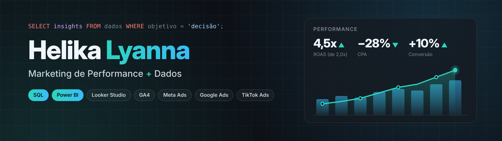

### Olá! Sou a Helika 👋

Trabalho há mais de 4 anos com marketing de performance (Meta Ads, Google Ads, TikTok Ads e Retail Media) e uso dados para orientar decisões: dashboards em Power BI e Looker Studio, análise de funil e consultas em SQL.

**Projetos**

- [Análise de Campanhas de Mídia Paga com SQL](https://github.com/hlyanna/analise-campanhas-sql): ROAS, CPA, ranking de campanhas e evolução diária com SQL Server.

**Contato**

[LinkedIn](https://www.linkedin.com/in/helikalyanna/) · helika.andrade@gmail.com
